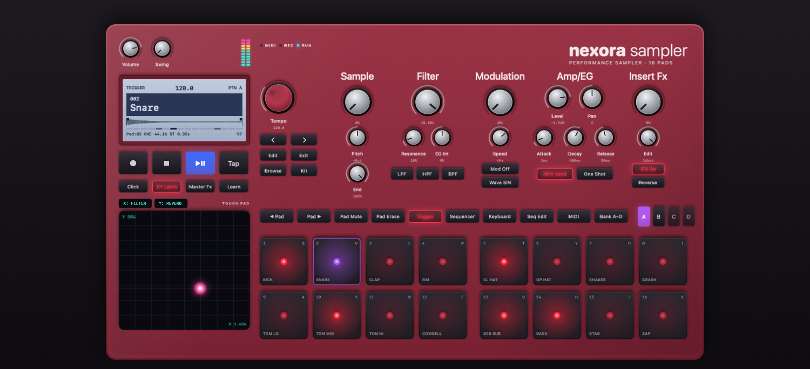
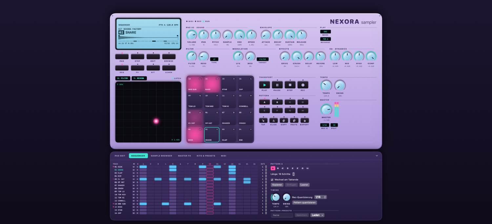
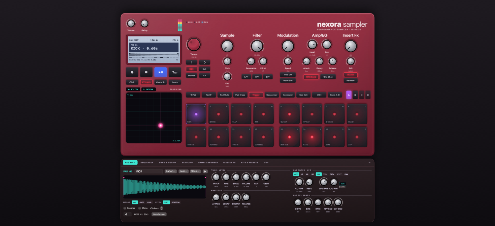
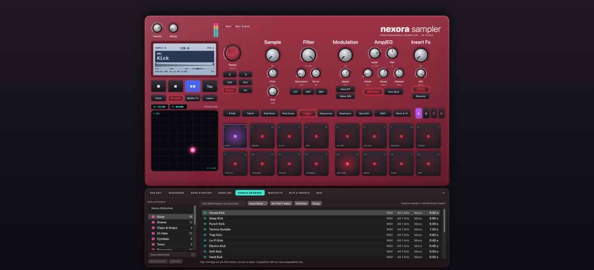
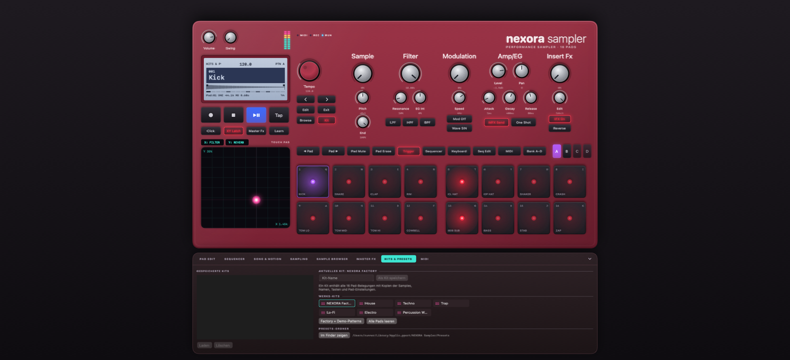
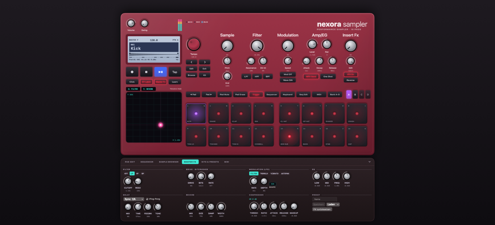
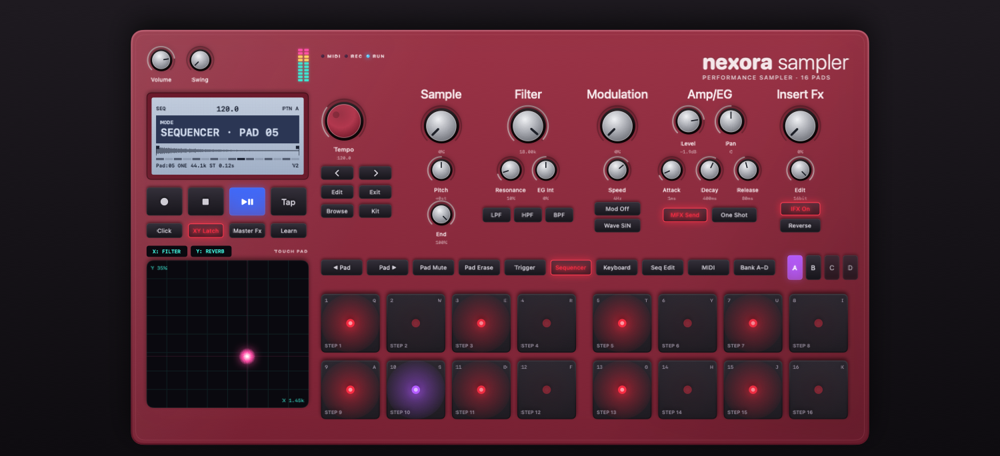
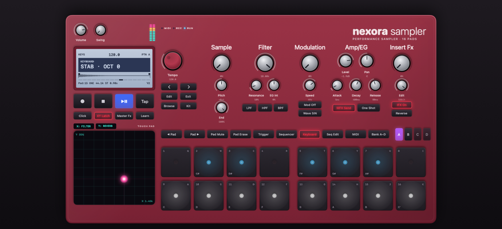
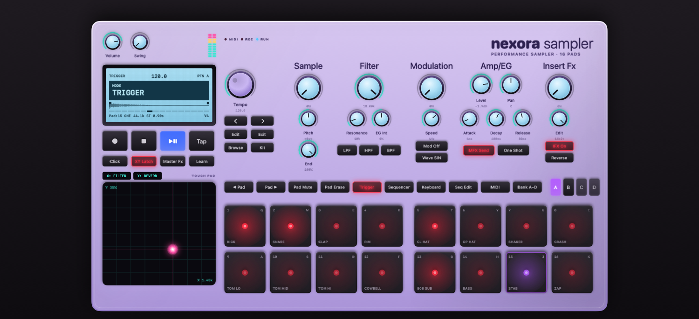

# NEXORA sampler

Nativer macOS-Sampler im Stil einer Hardware-Groovebox: lackiertes Gehäuse, Metall-Drehregler,
hintergrundbeleuchtetes LCD, Gummitasten mit leuchtender Beschriftung, 16 Pads (2 × 8) mit LEDs,
Touchpad und ein integrierter 16×16-Step-Sequencer – mit einer echten, echtzeitfähigen
Audio-Engine, Effekten, MIDI, Presets und Audio-Export.

* **Swift 5.9+ · SwiftUI · AVFoundation/AVAudioEngine · Core Audio · Core MIDI · Accelerate**
* keine externen Abhängigkeiten, läuft vollständig offline
* Universal-App (Apple Silicon + Intel), macOS 14 Sonoma oder neuer
* zwei Gehäusefarben: **Crimson** (Metallic-Rot, Standard) und **Lilac** – umschaltbar in den Einstellungen

---

## Screenshots

Automatisch auf macOS erzeugt (`--screenshots`, siehe CI-Workflow) – Demo-Pattern läuft, Pads leuchten im Takt.



| Sequencer | Pad-Editor |
|---|---|
|  |  |
| **Sample-Browser mit Werks-Bibliothek** | **Kits & Presets** |
|  |  |
| **Master-Effekte** | **Step-Modus** |
|  |  |
| **Keyboard-Modus** | **Farbschema Lilac** |
|  |  |

## Werks-Bibliothek

Beim ersten Start richtet die App **151 eingebaute Klänge** in 13 Kategorien ein (Fortschritt im LCD):
Kicks (18), Snares (12), Claps & Snaps (6), Hi-Hats (13), Cymbals (6), Toms (8), Percussion (24),
808 & Bass (16), Synth & Keys (13), Chords & Stabs (11), Pads & Atmos (6), Vocal Chops (8), FX (13).
Alle Klänge werden per Synthese erzeugt (keine mitgelieferten Fremd-Samples, keine Lizenzfragen) und als
WAV in `~/Library/Application Support/NEXORA Sampler/Library` abgelegt. Im **Sample-Browser** vorhören,
durchsuchen und auf Pads ziehen. Unter **KIT** stehen sieben fertige Werks-Kits bereit:
NEXORA Factory, House, Techno, Trap, Lo-Fi, Electro und Percussion World.

---

## Installation

### Voraussetzungen

| | |
|---|---|
| macOS | 14.0 (Sonoma) oder neuer |
| Xcode | **16 oder neuer** (das Projekt nutzt das Xcode‑16‑Projektformat mit synchronisierten Ordnern) |
| Apple-ID / Entwickler-Account | nicht nötig – die App wird lokal ad-hoc signiert |

### In Xcode bauen und starten

1. Ordner `NexoraSampler/` öffnen und **`NexoraSampler.xcodeproj`** doppelklicken.
2. Xcode löst automatisch das lokale Swift-Package `Packages/NexoraCore` auf (kein Internet nötig).
3. Oben das Scheme **NexoraSampler** und als Ziel **My Mac** wählen.
4. **⌘R** – die App startet mit dem eingebauten Werks-Kit und zwei Demo-Patterns. Leertaste drücken.

### Eigenständige `.app` erzeugen

**Variante A – Skript (empfohlen):**

```bash
cd NexoraSampler
./scripts/build-app.sh            # erzeugt dist/NEXORA Sampler.app und dist/NEXORA-Sampler-macOS.zip
```

**Variante B – Xcode:** *Product → Archive → Distribute App → Custom → Copy App*.

Danach `NEXORA Sampler.app` in den Ordner **Programme** ziehen.

> **Erster Start:** Die App ist nur ad-hoc signiert (nicht notarisiert). Falls macOS den Start
> blockiert: Rechtsklick auf die App → **Öffnen** → **Öffnen** bestätigen
> (oder *Systemeinstellungen → Datenschutz & Sicherheit → Trotzdem öffnen*).
> Für eine Weitergabe an Dritte in Xcode unter *Signing & Capabilities* ein eigenes Team eintragen
> und die App notarisieren.

### Tests ausführen

```bash
cd NexoraSampler
./scripts/test-core.sh            # = swift test im Package NexoraCore
```

oder in Xcode **⌘U** (das geteilte Scheme enthält die Test-Suite `NexoraCoreTests`).
93 Tests decken Audio-Engine, DSP-Effekte, Sequencer-Timing, Speicherformate, Presets,
Sample-Suche, WAV/AIFF-Export und MIDI-Parsing ab.

---

## Bedienung

### Aufbau der Oberfläche

```
┌─────────────────────────────────────────────────────────────────────────────────────────────┐
│ (Volume)(Swing)  ▮▮                                                  nexora sampler          │
│ ┌──── LCD ────┐   (TEMPO)    Sample     Filter      Modulation    Amp/EG        Insert Fx    │
│ │ 120.0  PTN A │   [<][>]     (Start)    (Cutoff)    (Depth)      (Level)(Pan)  (Drive)      │
│ │█ 002 Snare  █│   [Edit]     (Pitch)    (Reso)(EG)  (Speed)      (A)(D)(R)     (Edit=Bits)  │
│ │ Pad:02 ONE   │   [Exit]     (End)      LPF HPF BPF Target/Wave  MFX/AmpEG     IFX/Reverse  │
│ └──────────────┘   [Browse][Kit]                                                             │
│ [●][■][▶❚❚][Tap]   [◀Pad][Pad▶][Mute][Erase][Trigger][Sequencer][Keyboard][SeqEdit][MIDI][Bank]  A B C D │
│ [Click][Latch][MFX][Learn]                                                                    │
│ ┌── Touchpad ──┐   [ 1 ][ 2 ][ 3 ][ 4 ]   [ 5 ][ 6 ][ 7 ][ 8 ]                              │
│ │      ●       │   [ 9 ][10 ][11 ][12 ]   [13 ][14 ][15 ][16 ]                              │
│ └──────────────┘                                                                              │
└─────────────────────────────────────────────────────────────────────────────────────────────┘
        ▼ ausklappbarer Bereich: PAD EDIT · SEQUENCER · SAMPLE BROWSER · MASTER FX · KITS & PRESETS · MIDI
```

Die fünf Regler-Sektionen wirken auf das **ausgewählte Pad**; die Master-Effekte (Delay, Hall, EQ, Kompressor,
Master-Filter, Modulation) liegen unter **Master Fx** und auf dem Touchpad. Das Instrument skaliert mit der Fenstergröße.

### Drehregler

* **Ziehen** (hoch/runter oder links/rechts, Maus oder Trackpad) ändert den Wert – sofort hörbar.
* **⌥ oder ⇧ gedrückt halten** = Feineinstellung, **Doppelklick** = Standardwert.
* Der Wert steht unter dem Regler und groß im LCD.
* **Rechtsklick:** MIDI-Learn, MIDI-Zuordnung entfernen, auf XY-Pad-Achse legen, zurücksetzen.
* Obere Reihe = ausgewähltes Pad, untere Reihe = Master (Filter, Modulation, Effekte, EQ/Kompressor).

### Pads

* **Klicken** spielt das Pad; die Klickposition bestimmt die Anschlagstärke (oben laut, unten leise – abschaltbar).
* **Tastatur:** `Q W E R T Y U I` = Pads 1–8 (obere Reihe), `A S D F G H J K` = Pads 9–16 (untere Reihe) – frei änderbar im Pad-Editor.
* **Pad-Modi** (Tasten über den Pads): **Trigger** = Pads spielen, **Sequencer** = Pads schalten die 16 Schritte der
  ausgewählten Spur, **Keyboard** = Pads spielen das ausgewählte Sample chromatisch (untere Reihe weiße, obere Reihe
  schwarze Tasten; Oktave mit ⌥⌘↑/↓).
* **Audiodateien** (WAV, AIFF, MP3, M4A – zusätzlich CAF, FLAC) aus dem Finder oder dem Browser auf ein Pad ziehen.
  Mehrere Dateien werden auf aufeinanderfolgende Pads verteilt.
* Rechtsklick: Sample laden, bearbeiten, MIDI-Note lernen, Spur löschen, Pad leeren.
* Pads leuchten pink im Rhythmus ihrer Hüllkurve; das ausgewählte Pad hat einen türkisen Rahmen.

### Pad-Editor (EDIT)

Wellenform mit ziehbaren Start-/Endmarkern, Name, Taste, MIDI-Note, Wiedergabemodus
(One-Shot / Gate / Loop), Reverse, Pitch-Modus (Varispeed oder Time-Stretch), Mono, Choke-Gruppe,
Pitch/Fine/Speed/Volume/Pan/Velocity, ADSR, Pad-Filter (LP/HP/BP, Cutoff, Resonanz),
Pad-LFO (Vibrato, Tremolo, Filter, Auto-Pan), Drive, Bitcrusher sowie Reverb- und Delay-Send.

### Sequencer (SEQ / STEP)

* **STEP-Taste:** Die 16 Pads zeigen und schalten die 16 Schritte der ausgewählten Spur (wie bei Hardware-Samplern).
* **SEQ-Bereich:** vollständiges 16 Spuren × 16 Schritte-Raster. Klick = Schritt an/aus, **⇧-Klick** = Anschlagstärke (100/70/40 %).
  Pro Spur Mute, Solo und Notenlänge (Gate) für Gate/Loop-Pads.
* 8 Patterns (A–H), Länge 1–16 Schritte, Kopieren/Einfügen/Leeren, Wechsel am Taktende oder sofort.
* Tempo 40–300 BPM, Tap-Tempo, Swing 50–75 %, Metronom.
* **Live-Aufnahme:** REC (⌘R) aktivieren und Pads spielen. Rec-Quantisierung 1/16, 1/8, 1/4 oder AUS
  (dann wird das Mikro-Timing gespeichert und kann später mit „Pattern quantisieren“ entfernt werden).
* Play/Stop: Leertaste, Pause setzt an derselben Stelle fort.

### XY-Pad

Ziehen steuert zwei Parameter gleichzeitig in Echtzeit (Standard: X = Filter-Cutoff, Y = Reverb-Mix).
Achsen über die Menüs oben am Pad oder per Rechtsklick auf einen Regler zuweisen.
**LATCH** aus: Werte springen beim Loslassen zurück.

### Sample-Browser (BROWSE)

Eigene Bibliotheken anlegen/umbenennen/löschen, Dateien importieren (⌘I oder per Drag & Drop aus
dem Finder), vorhören (automatisch beim Auswählen), umbenennen, entfernen, per Doppelklick auf das
ausgewählte Pad laden oder direkt auf ein Pad ziehen. Importierte Dateien werden standardmäßig in
die Bibliothek kopiert (`~/Library/Application Support/NEXORA Sampler/Library`).

### Projekte, Kits und Presets

* **Projekt** (⌘S / ⇧⌘S / ⌘O): Ordner-Paket `Name.nexora` mit `project.json` und Kopien **aller** Samples –
  Projekte sind dadurch in sich geschlossen und können verschoben oder weitergegeben werden.
* **Kits** (KIT): alle 16 Pad-Belegungen inklusive Samples und Pad-Einstellungen.
* **Effekt-Presets** (FX) und **Pattern-Presets** (SEQ).
* Format-Dokumentation: [`docs/PROJECT_FORMAT.md`](docs/PROJECT_FORMAT.md)

### MIDI

* Alle angeschlossenen MIDI-Geräte (Keyboards, Pad-Controller) werden automatisch verbunden, auch beim An-/Abstecken.
* Pad-Noten standardmäßig C1–D#2 (36–51, kompatibel mit gängigen Pad-Controllern), einzeln änderbar oder per „Note lernen“.
* **MIDI-Learn:** LEARN drücken → Regler anklicken → Controller am Gerät bewegen. Zuordnungen im MIDI-Bereich verwalten.
* Eingangskanal (Omni oder 1–16), Start/Stop/Continue vom Gerät, feste Anschlagstärke.

### Export (⌘E)

WAV oder AIFF, Stereo, 44,1 oder 48 kHz, 16/24 Bit (WAV zusätzlich 32 Bit Float), Wiederholungen,
Ausklingzeit für Hall/Delay, optional Pattern-Kette (z. B. `A A B A`) und Normalisierung.
Gerendert wird offline mit **derselben Engine** wie bei der Wiedergabe – der Export enthält exakt das hörbare Signal.

### Einstellungen (⌘,)

Audio-Ausgabegerät, Puffergröße (32–1024 Samples) mit Latenzanzeige, Polyphonie (1–64), Voice-Stealing-Strategie
(älteste, leiseste, gleiches Pad zuerst, keine), Projektname/Tempo/Swing, Pad-Anschlag, MIDI an/aus, Bibliotheksoptionen.

### Tastaturkürzel

| Kürzel | Funktion |
|---|---|
| Leertaste | Play / Stop |
| ⌘↩ / ⌘. | Play/Stop / Pause |
| ⌘R / ⌘K / ⌘T | Aufnahme / Metronom / Tap-Tempo |
| ⌘1 … ⌘8 | Pattern A … H |
| ⌘N / ⌘O / ⌘S / ⇧⌘S | Neu / Öffnen / Sichern / Sichern unter |
| ⌘I / ⌘L / ⌘E | Samples importieren / Sample auf Pad laden / Audio exportieren |
| ⌥⌘1 … ⌥⌘6, ⌥⌘0 | Bereiche Pad-Editor, Sequencer, Browser, FX, Kits, MIDI / schließen |
| ⌥⌘P / ⌥⌘T / ⌥⌘K | Trigger- / Sequencer- / Keyboard-Modus · ⌥⌘↑/↓ Oktave |
| ⇧⌘M | MIDI-Learn |
| Esc | Alle Noten aus |

---

## Projektstruktur

```
NexoraSampler/
├── NexoraSampler.xcodeproj        Xcode-Projekt (App-Target + lokales Package, geteiltes Scheme)
├── Config/Info.plist              Dokumenttypen .nexora / .nexorakit
├── NexoraSampler/                 macOS-App (SwiftUI)
│   ├── App/                       App-Einstieg, Menüs, AppDelegate
│   ├── Controllers/               SamplerController (Zustand & Aktionen), MeterModel, LibraryModel
│   ├── Views/                     Gehäuse, LCD, Knob-Bank, Pads, XY-Pad, Transport, Export, Einstellungen
│   │   └── Drawer/                Pad-Editor, Sequencer, Browser, FX, Kits, MIDI
│   ├── Components/                Designsystem, Drehregler, Hardware-Tasten, LEDs, Wellenform
│   ├── Audio/                     AVAudioEngine-Host, Core-Audio-Geräte
│   ├── MIDI/                      Core-MIDI-Anbindung
│   └── Resources/                 Asset-Katalog (App-Icon)
├── Packages/NexoraCore/           plattformunabhängiger Kern (Swift Package)
│   ├── Sources/NexoraCore/
│   │   ├── DSP/                   Filter, EQ, Hüllkurve, LFO, Delay, Hall, Drive, Bitcrusher, Kompressor, vDSP
│   │   ├── Engine/                SamplerEngine, Stimmen, Echtzeit-Queues, Status
│   │   ├── Sequencer/             sample-genauer Sequencer, Quantisierung
│   │   ├── Models/                Projekt, Pads, Master, Patterns, Parameter-Registry, MIDI-Einstellungen
│   │   ├── Presets/               Projekt-/Kit-Pakete, Preset-Speicher, Sample-Bibliothek, Sample-Suche
│   │   ├── Export/                Offline-Renderer, WAV/AIFF-Schreiben und -Lesen
│   │   ├── MIDI/                  MIDI-1.0- und UMP-Parser
│   │   ├── Audio/                 AudioFileLoader (AVAudioFile)
│   │   └── Factory/               synthetisiertes Werks-Kit + Demo-Patterns
│   └── Tests/NexoraCoreTests/     93 Tests
├── docs/                          ARCHITECTURE.md, PROJECT_FORMAT.md
└── scripts/                       build-app.sh, test-core.sh
```

Die geforderten Bereiche *DSP, Sequencer, Models, Presets, Tests* liegen im Package `NexoraCore`
(Audioverarbeitung und Datenmodelle sind so strikt von der Oberfläche getrennt und ohne UI testbar);
*App, Views, Components, Audio, MIDI, Resources* liegen im App-Target. Details: [`docs/ARCHITECTURE.md`](docs/ARCHITECTURE.md).

---

## Referenzvideo, Umsetzung und Abweichungen

**Referenzvideo:** Das Video lag bei der Entwicklung nicht vor. Die Optik wurde daher ausschließlich nach der
schriftlichen Beschreibung umgesetzt. Sobald Screenshots vorliegen, lassen sich Farben (`Components/DesignSystem.swift`),
Maße und die Anordnung (`Views/MainView.swift`, `Views/KnobBankView.swift`) gezielt nachjustieren.

**Aus der Beschreibung übernommen (Gehäuse/Front):** pastell-lila Gehäuse mit dunkelvioletten Flächen, Schriftzug
„NEXORA sampler“ oben rechts, hellblaues LCD oben links (Sample, Kit/Preset, BPM, Sample-Infos, Modus), schwarze
Funktionstasten darunter, zahlreiche hellblaue Drehregler mit dunkler Markierung in Mitte und rechts (u. a. Volume,
Sample, Filter, Modulation, Pitch, Resonance, EQ, Delay, Reverb, Pan, LFO), 16 quadratische Pads im 4×4-Raster unten,
großes schwarzes XY-Touchpad mit leuchtendem Punkt unten links, pinke LEDs und türkise Akzente.

**Zusätzlich vorgeschlagen (ohne die Front zu verändern):** ausklappbarer Bereich unter dem Gehäuse (Pad-Editor,
16×16-Sequencer-Raster, Browser, Master-FX, Kits, MIDI), Transport-/Pattern-Tasten neben den Pads, Tap-Tempo,
Metronom, Pegel-LEDs, Status-LEDs (MIDI/REC/RUN), Kontextmenüs, Einstellungsfenster.

**Technische Entscheidungen und Abweichungen:**

* **Eigene DSP-Engine statt AVAudioUnit-Effektknoten.** AVAudioEngine stellt die Audio-Ausgabe (über einen
  `AVAudioSourceNode`); Stimmen, Filter, Hall, Delay, EQ, Kompressor usw. laufen in einer eigenen Render-Funktion
  (vektorisiert mit Accelerate/vDSP). Nur so sind Effekte **pro Pad**, ein **sample-genauer** Sequencer und ein
  **Export, der bitgenau dem Gehörten entspricht**, möglich – und die DSP-Algorithmen sind unabhängig testbar.
* **Pitch und Speed:** Im Modus *Varispeed* sind Tonhöhe und Geschwindigkeit wie bei klassischen Samplern gekoppelt
  (Resampling mit kubischer Interpolation). Für unabhängige Tonhöhe/Geschwindigkeit gibt es den Modus *Time-Stretch*
  (granulares Overlap-Add mit Hann-Fenstern; bei sehr perkussivem Material hörbar körniger als Studio-Algorithmen).
* **Anschlagstärke per Maus:** Mäuse/Trackpads liefern im Pad-Kontext keinen Druck; die Anschlagstärke ergibt sich
  daher aus der vertikalen Klickposition (abschaltbar). MIDI- und Tastatur-Anschläge bleiben davon unberührt.
* **Drehregler** werden per Ziehen bedient (Maus und Trackpad); Mausrad-Scrollen ist nicht belegt.
* **AIFF** wird mit 16/24 Bit geschrieben; 32-Bit-Float ist nur als WAV verfügbar.
* **Keine App-Sandbox**, ad-hoc-Signatur – für den lokalen Einsatz gedacht (siehe Installation).

## Verifikationsstand

* **macOS-Build erfolgreich** (GitHub Actions, macOS 15, Xcode 16.4): Universal-Binary (arm64 + x86_64),
  ad-hoc signiert, Dokumenttypen `.nexora`/`.nexorakit` im Info.plist. Die fertige App liegt als Artefakt
  `NEXORA-Sampler-macOS` beim jeweiligen Lauf des Workflows `.github/workflows/nexora-sampler.yml`.
* **Alle 93 Kern-Tests bestehen** unter macOS und Linux (Engine, DSP-Effekte, Sequencer-Timing auf ±1 Sample,
  Speicherformate, Presets, Sample-Suche, WAV/AIFF-Export, MIDI-Parsing).
* Performance (Release): 64 Stimmen mit Pad-Filter, LFO und vollständiger Master-Kette ≈ 8 % eines CPU-Kerns.
* Noch nicht automatisiert geprüft: die Bedienung der Oberfläche und die Audio-/MIDI-Hardware im laufenden
  Programm (CI-Runner haben weder Bildschirm noch Audiogerät) – das bitte beim ersten Start auf dem eigenen Mac testen.
