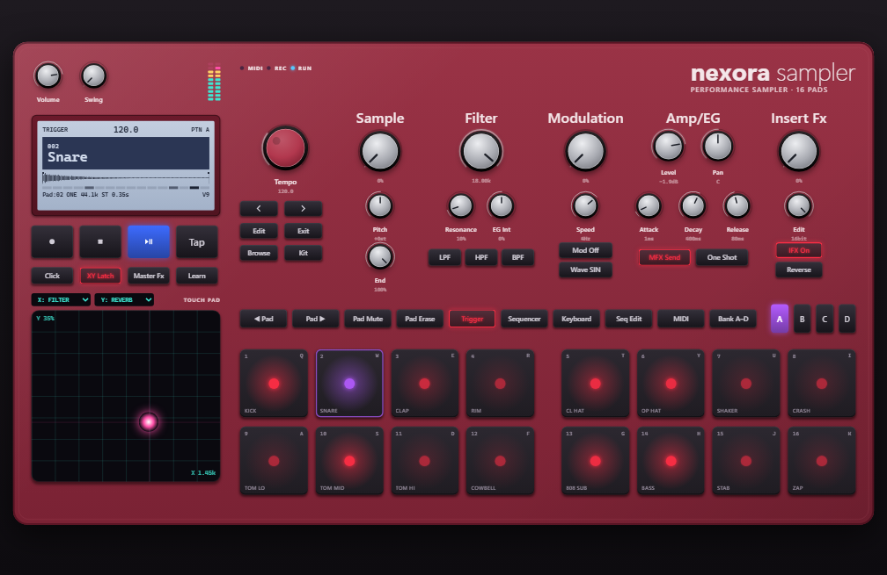

# NEXORA Sampler für Windows

Die Windows-Version des NEXORA Samplers – gleiche Oberfläche, gleiche Klänge, gleiche Funktionen
und **dasselbe Projektformat** wie die Mac-Version. Projekte (`.nexora`), Kits und Presets lassen sich
zwischen Mac und Windows austauschen.



## Installation

1. Auf GitHub unter **Actions → „NEXORA Sampler (macOS + Windows build & tests)“** den neuesten grünen Lauf öffnen.
2. Unten bei *Artifacts* **NEXORA-Sampler-Windows** herunterladen und entpacken. Darin liegen:
   * `NEXORA-Sampler-1.0.0-Setup.exe` – **Installer** (Startmenü- und Desktop-Verknüpfung)
   * `NEXORA-Sampler-1.0.0-portable.exe` – **portable Version**, läuft ohne Installation (z. B. vom USB-Stick)
3. Starten. Da die App (noch) nicht mit einem kostenpflichtigen Zertifikat signiert ist, zeigt Windows
   beim ersten Start eventuell „Der Computer wurde durch Windows geschützt“ (SmartScreen):
   **Weitere Informationen → Trotzdem ausführen**.

Voraussetzung: Windows 10 oder 11 (64 Bit).

## Bedienung

Die Bedienung ist identisch zur Mac-Version (siehe Haupt-README). Abweichungen:

| Mac | Windows |
|---|---|
| ⌘ (Command) | **Strg** – z. B. Strg+S speichern, Strg+E exportieren, Strg+1 … Strg+8 Pattern |
| ⌥⌘P / ⌥⌘T / ⌥⌘K | Strg+Alt+P / T / K (Trigger-, Sequencer-, Keyboard-Modus) |
| Esc = alle Noten aus | Umschalt+Esc |
| Einstellungen ⌘, | Strg+, oder Menü *Datei → Einstellungen* |
| Projekt = Paket im Finder | Projekt = **Ordner** `Name.nexora` (zum Öffnen den Ordner auswählen) |

Zusätzlich lassen sich alle Drehregler unter Windows auch mit dem **Mausrad** bedienen (Umschalt = fein).

Tastatur: `Q W E R T Y U I` = Pads 1–8, `A S D F G H J K` = Pads 9–16, Leertaste = Play/Stop.

Daten liegen unter `%APPDATA%\NEXORA Sampler` (eigene Bibliotheken, Kits, Effekt- und Pattern-Presets).
Die 151 Werks-Klänge sind schreibgeschützt in der App enthalten.

## Technik

| Bereich | Umsetzung |
|---|---|
| App-Hülle | Electron 37 (Chromium) – Fenster, Menüs, Dateidialoge, Dateizugriff |
| Audio-Engine | 1:1-Portierung der Swift-Engine nach JavaScript, läuft im **AudioWorklet** (eigener Echtzeit-Audio-Thread) |
| Sequencer | sample-genau im Audio-Thread, unabhängig von der Oberfläche |
| Effekte | gleiche Algorithmen wie auf dem Mac (SVF-Filter, Freeverb, Delay, EQ, Kompressor, Drive, Bitcrusher, Vibrato) |
| Export | Offline-Rendering mit derselben Engine in einem Hintergrund-Thread (Web Worker) |
| MIDI | Web MIDI (alle angeschlossenen Geräte, Hot-Plug) |
| Dateiformate | WAV/AIFF (eigener Decoder), MP3/M4A/AAC/FLAC/OGG (Chromium-Decoder) |
| Werks-Klänge | werden aus dem Swift-Kern exportiert und sind bitgleich mit der Mac-Version |

**Abweichungen zur Mac-Version**

* Die Audioausgabe läuft über Web Audio (unter Windows: WASAPI im Shared-Modus). Die Latenz liegt je nach
  Gerät typischerweise bei 10–25 ms und ist in den Einstellungen wählbar (Niedrig/Ausgewogen/Hoch).
  **ASIO-Treiber werden nicht unterstützt.**
* Die Rechenleistung der JavaScript-Engine ist etwas geringer als die der nativen Mac-Engine
  (64 Stimmen mit Filter, LFO und voller Effektkette ≈ ein Drittel eines CPU-Kerns).
* `.nexora`-Projekte sind Ordner. Ein Doppelklick im Explorer öffnet daher nicht die App,
  sondern den Ordner – Projekte über *Datei → Projekt öffnen* laden.

## Selbst bauen

Voraussetzungen: Node.js 22 und – nur für den Export der Werks-Klänge – eine Swift-Toolchain (5.9 oder neuer).

```bash
cd NexoraSampler/Windows
npm ci
npm run factory     # erzeugt resources/factory aus dem Swift-Kern (alternativ Artefakt „NEXORA-Factory-Sounds“ aus der CI entpacken)
npm test            # Engine-Tests
npm start           # App starten
npm run dist        # Installer + portable EXE in dist/ (unter Windows ausführen)
```

Ohne Electron lässt sich die Oberfläche zum Entwickeln auch im Browser öffnen
(`python -m http.server` im Ordner `Windows`, dann `http://localhost:8000/src/index.html`);
Dateidialoge sind dort nicht verfügbar.

## Aufbau

```
Windows/
├── main.cjs            Electron-Hauptprozess: Fenster, Menüs, Dialoge, Dateizugriff, Screenshot-Modus
├── preload.cjs         sichere Brücke zur Oberfläche
├── src/
│   ├── index.html, styles.css, app.js
│   ├── engine/         dsp.js, engine.js, model.js, offline.js, audiofile.js, worklet.js, export-worker.js
│   ├── core/           controller.js, audio.js, library.js, projectio.js, midi.js, bridge.js
│   └── ui/             body.js (Gehäuse), knob.js, drawers.js, dialogs.js, dom.js, screenshots.js
├── test/               Engine-Tests (node --test)
└── resources/factory/  Werks-Klänge (generiert)
```
